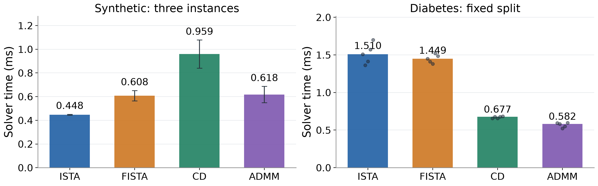

# Classical Optimization Algorithms for Lasso Regression

**COMP6704: Advanced Topics in Optimization · Group 9**  
**The Hong Kong Polytechnic University · Fall 2026**

This repository presents a reproducible study of four classical algorithms for convex Lasso regression: the Iterative Shrinkage-Thresholding Algorithm (ISTA), the Fast Iterative Shrinkage-Thresholding Algorithm (FISTA), cyclic coordinate descent (CD), and the Alternating Direction Method of Multipliers (ADMM). The study connects mathematical formulation and convergence theory with measured computational efficiency, numerical accuracy, and sparsity. All four implementations solve the same training problems under a common stationarity-based stopping criterion.

[Project report](02_Report/Lasso_Project_Report.pdf) · [Editable presentation](05_Presentation/COMP6704_Group9_Lasso_Presentation.pptx) · [Combined submission](06_Submission/Group9.pdf) · [Solver implementations](03_Code_and_Results/src/optimizers.py) · [Recorded experiments](03_Code_and_Results/results/2026-11-06-four-solvers/)

## Project Materials

| Material | Contents |
|---|---|
| [Report](02_Report/Lasso_Project_Report.pdf) | A 15-page manuscript, including references and confirmed author contributions |
| [Presentation](05_Presentation/COMP6704_Group9_Lasso_Presentation.pptx) | An editable 34-slide deck: 30 main slides, one Q&A slide, and three backup/reference slides |
| [Bilingual speaker notes](05_Presentation/Speaker_Notes_Bilingual.txt) | Alternative English and Chinese scripts, with a 30-minute presentation plan and a separate 10-minute Q&A |
| [Combined submission](06_Submission/Group9.pdf) | Report followed by presentation slides: 49 pages, approximately 2.08 MB |

## Research Objectives

The project investigates how update mechanisms and data geometry affect the practical solution of a fixed convex optimization problem. In particular, we examine:

1. The relationship between theoretical objective-error bounds and the computation required to reach a common stationarity tolerance.
2. The effects of predictor correlation, feature dimension, and implementation overhead on solver performance.
3. The distinct roles of statistical regularization and algorithmic parameter selection in prediction, sparsity, and convergence.

## Problem Formulation

For a training matrix $X\in\mathbb{R}^{n\times d}$, centered response vector $y\in\mathbb{R}^{n}$, and coefficients $w\in\mathbb{R}^{d}$, all methods minimize

$$
F(w)=\frac{1}{2n}\lVert Xw-y\rVert_2^2+\lambda\lVert w\rVert_1,
\qquad \lambda>0.
$$

Predictors are centered and standardized using training statistics, which are subsequently applied to the test data. Predictions restore the training response mean, yielding an unpenalized intercept. The main benchmark uses $\lambda=0.1\lambda_{\max}$, where $\lambda_{\max}=\lVert X^\top y/n\rVert_\infty$.

## Implemented Algorithms

| Method | Update mechanism | Dense work per monitored round |
|---|---|---|
| **ISTA** | Gradient step followed by soft thresholding | `O(nd)` |
| **FISTA** | Extrapolation followed by a proximal-gradient step | `O(nd)` |
| **Cyclic CD** | Exact scalar minimization with residual reuse | `O(nd)` per complete sweep |
| **ADMM** | Cached linear solve, soft thresholding, and a scaled dual update | `O(nd + d²)` |

ISTA and FISTA use a step size of $1/L$, with $L=\lVert X\rVert_2^2/n$. FISTA is implemented in its standard form without restart. CD visits all coordinates in a fixed cyclic order.

ADMM separates the squared loss and the L1 penalty through the constraint $x=z$. Its returned coefficient vector is $w=z$, and both the objective and common stationarity residual are evaluated at that vector. The dense implementation forms and factors $X^\top X/n+\beta I$ once within each solve. Gram construction and Cholesky factorization, with preparation cost `O(nd² + d³)`, are included in the reported cold runtime. The main comparison fixes $\beta=1$; the code names this parameter `admm_rho`. Predictor correlation is denoted separately by $\rho$.

## Experimental Design

| Study | Design |
|---|---|
| Synthetic sparse regression | Three instances with 300 observations, 50 predictors, five active generating coefficients, and fixed 240/60 training/test splits |
| Diabetes regression | 442 observations and ten predictors, with one saved 353/89 training/test split |
| Predictor correlation | 600 observations and 60 predictors; four within-block correlation levels, with paired seeds and splits |
| Feature dimension | 1,000 observations and 50, 100, 300, or 600 predictors; paired matrix prefixes and responses |
| Parameter sensitivity | Four model-penalty ratios, 34-point coefficient paths, and ADMM penalties $\beta\in\{0.1,1,10\}$ |

Every solver starts from zero and stops when the normalized proximal-gradient residual satisfies $R(w)\leq10^{-6}$, subject to a maximum of 10,000 rounds. ADMM additionally records primal and dual residuals as diagnostics. A small $R$ measures stationarity; it is not an upper bound on objective suboptimality.

Each primary instance–method pair has five interleaved timing repetitions. Elapsed time includes solver preparation, objective and residual monitoring, and history recording. Data loading, preprocessing, the shared spectral-norm calculation, and plotting are excluded; spectral setup is recorded separately. Detected numerical thread pools are limited to one thread.

The recorded release contains **560 primary timing runs**, **45 ADMM parameter-sensitivity timing runs**, **16 model-penalty fits**, and **68 coefficient-path fits**, all of which reached their prescribed stopping thresholds. Six numerical tests validate the implementations against analytic solutions, an independent reference solver, and additional ADMM-specific cases.

## Principal Findings

The following runtimes are measured in milliseconds in the recorded numerical environment. Each instance contributes the median of five repetitions; entries with uncertainty report the mean and sample standard deviation across three instances.

| Setting | ISTA | FISTA | Cyclic CD | ADMM |
|---|---:|---:|---:|---:|
| Original synthetic instances | 0.448 ± 0.004 | 0.608 ± 0.044 | 0.959 ± 0.119 | 0.618 ± 0.069 |
| Diabetes, fixed split | 1.510 | 1.449 | 0.677 | 0.582 |
| Within-block correlation $\rho=0.99$ | 177.997 ± 16.772 | 24.041 ± 23.123 | 101.630 ± 18.160 | 17.457 ± 1.401 |

- **Performance depends on the design.** ISTA has the lowest mean runtime in the tested independent-feature settings. ADMM has the lowest median on the saved Diabetes split and the lowest mean at the three positive block-correlation levels.
- **Instance variation matters.** At $\rho=0.99$, FISTA is faster on two of the three instances, despite ADMM's lower mean. The aggregate result does not establish uniform dominance.
- **Preparation changes the cost comparison.** At 600 predictors, ADMM requires 17.413 ms on average, including 8.251 ms of preparation. Fewer rounds therefore need not imply lower total runtime.
- **Accurate solvers produce nearly identical fitted results.** At a fixed model penalty, differences in test error are too small to support a predictive ranking of the optimizers.
- **Sparsity and estimation accuracy are distinct.** Correct synthetic support recovery coexists with coefficient shrinkage; stronger model penalties can yield smaller models with higher test error.



These findings concern the recorded dense implementations and monitoring protocol. Three synthetic instances, one real-data split, and short timing repetitions support descriptive comparisons rather than general statistical guarantees. The complete analysis and qualifications appear in the [report](02_Report/Lasso_Project_Report.pdf).

## Repository Structure

```text
.
├── README.md                    # Academic project overview
├── 01_Chinese_Guide/             # Historical supplementary notes
├── 02_Report/                   # Project report
├── 03_Code_and_Results/
│   ├── src/optimizers.py         # Four solver implementations
│   ├── tests/                   # Numerical correctness checks
│   ├── scripts/                 # Experiments, analysis, plotting, and report generation
│   ├── data/                    # Saved inputs, splits, and input manifest
│   ├── results/                 # Frozen experiment records and source snapshots
│   ├── output/figures/           # Figures generated from saved results
│   ├── templates/               # Manuscript template and bibliography
│   ├── requirements-admm.txt     # Recorded numerical environment
│   └── report.tex               # Generated report source
├── 04_Figures/                  # Report and projection-ready figures
├── 05_Presentation/             # Editable slides, PDF, bilingual notes, and timing
├── 06_Submission/Group9.pdf      # Combined report and presentation
├── .gitattributes               # Byte-preserving checkout for integrity checks
├── FILE_MANIFEST_SHA256.csv      # Package integrity checksums
└── PACKAGE_METADATA.json         # Release metadata
```

The current numerical release is stored under `03_Code_and_Results/results/2026-11-06-four-solvers/`, with `main`, `extended`, and `sensitivity` subdirectories. Earlier results are retained for traceability and are not pooled with the current same-host timings.

## Reproducing the Numerical Study

The recorded experiments used **Python 3.10.12**, NumPy 2.2.6, SciPy 1.15.3, scikit-learn 1.7.2, and Matplotlib 3.10.9 on an x86-64 Linux/WSL2 host. The exact dependency set is provided in `requirements-admm.txt`.

```bash
git clone https://github.com/Caiyangxiao/COMP6704-Group9-Project.git
cd COMP6704-Group9-Project/03_Code_and_Results
python -m venv .venv
```

Use Python 3.10 for the recorded numerical environment. Activate the environment with `source .venv/bin/activate` on Linux/macOS, or `.\.venv\Scripts\Activate.ps1` in Windows PowerShell. Then run:

```bash
python -m pip install -r requirements-admm.txt
python -m unittest discover -s tests -v
python scripts/reproduce_four_solver_study.py --output results/reproduction-01
```

The reproduction script runs the main, controlled, and ADMM-sensitivity studies sequentially. Its output directory must be new, preserving existing experiment records. Absolute runtimes depend on the host; replication should first assess convergence and numerical agreement.

To regenerate figures and the manuscript from that result directory, without additional model fitting:

```bash
python scripts/plot_four_solver_results.py --results results/reproduction-01
python scripts/build_four_solver_report.py --results results/reproduction-01
```

The plotting script exports PNG, SVG, and vector PDF figures. The report builder refreshes `report.tex` from saved numerical records. With Tectonic installed, compile from the same directory:

```bash
tectonic --keep-logs --outdir ../02_Report report.tex
```

This produces `02_Report/report.pdf`; after review, it can replace the canonical `Lasso_Project_Report.pdf`. Detailed instructions are available in the [replication guide](03_Code_and_Results/README.txt).

## Presentation and Submission Workflow

Presentation generation reads the frozen experiment records and has a separate dependency set in `03_Code_and_Results/requirements-presentation.txt`. From `03_Code_and_Results`, use a separate Python environment for this workflow:

```bash
python -m pip install -r requirements-presentation.txt
python scripts/plot_presentation_assets.py
python scripts/build_presentation.py
```

On Windows with Microsoft PowerPoint installed, export the slides and regenerate the combined submission:

```powershell
powershell -NoProfile -File scripts/export_presentation.ps1
python scripts/combine_submission.py
```

The merge preserves searchable text, links, bookmarks, and the original portrait/landscape page sizes. See the [presentation guide](05_Presentation/README.txt) for source files, speaker assignments, and the detailed schedule.

## Reproducibility Records

Repository attributes disable automatic line-ending conversion so that files retain the exact bytes covered by the SHA-256 manifests. This is required by the input-integrity checks across operating systems.

Saved evidence includes input hashes, fixed split assignments, actual controlled-study inputs, coefficients, raw timing repetitions, representative trajectories, ADMM diagnostics, configurations, environment versions, validation outputs, and source snapshots. The recorded checks include orthogonal closed-form solutions, a tight scikit-learn Lasso reference, the zero-solution threshold, and a rank-deficient underdetermined case. Numerical tests establish correctness within the tested cases; they do not establish a universal runtime ordering.

## Team Contributions

| Member | Student ID | Algorithm implementation | Presentation responsibility |
|---|---|---|---|
| CAI Yangxiao | 26023041R | ADMM | Part I: Background and formulation |
| XUE Pengyu | 26022951R | FISTA | Part II: Algorithms and experimental design |
| ZHANG Kejia | 26049131R | Cyclic coordinate descent | Introduction, work overview, and PPT design |
| ZHOU Xiyu | 26025265R | ISTA | Part III: Results and conclusions |

All four members jointly contributed to **report writing and revision**, **experimental design**, and **experimental evaluation**. Generative AI tools assisted with implementation, drafting, and language and formatting revision, as disclosed in the report. Reported measurements were executed locally and retained with their supporting records.

## Selected References

1. Tibshirani, R. (1996). [Regression shrinkage and selection via the lasso](https://doi.org/10.1111/j.2517-6161.1996.tb02080.x). *Journal of the Royal Statistical Society: Series B*, 58(1), 267–288.
2. Beck, A., & Teboulle, M. (2009). [A fast iterative shrinkage-thresholding algorithm for linear inverse problems](https://doi.org/10.1137/080716542). *SIAM Journal on Imaging Sciences*, 2(1), 183–202.
3. Friedman, J., Hastie, T., & Tibshirani, R. (2010). [Regularization paths for generalized linear models via coordinate descent](https://doi.org/10.18637/jss.v033.i01). *Journal of Statistical Software*, 33(1), 1–22.
4. Boyd, S., Parikh, N., Chu, E., Peleato, B., & Eckstein, J. (2011). [Distributed optimization and statistical learning via the alternating direction method of multipliers](https://doi.org/10.1561/2200000016). *Foundations and Trends in Machine Learning*, 3(1), 1–122.
5. Parikh, N., & Boyd, S. (2014). [Proximal algorithms](https://doi.org/10.1561/2400000003). *Foundations and Trends in Optimization*, 1(3), 127–239.

The full literature review and bibliography are provided in the project report.
